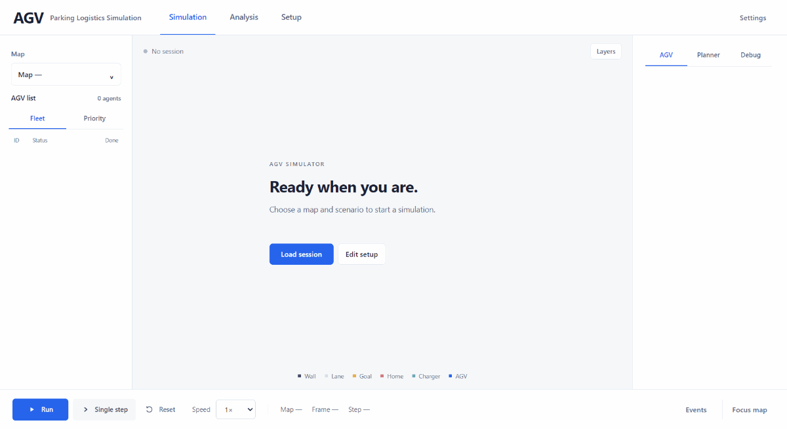

# 🚗🤖 AGV_REFACTORING

AGV(무인 운반차)의 이동과 작업을 **C++ 엔진**으로 시뮬레이션하고 **Electron UI**로 시각화하는 데스크톱 앱입니다.

## 🎬 미리보기



## ✨ 주요 기능

- 🗺️ **맵과 경로 계획** — 7개 맵, `default` · `astar` · `dstar` 알고리즘
- 🎛️ **시나리오 설정** — 사용자 정의·실시간 모드, 프리셋, 주차·출차·충전 작업
- 📊 **실행과 분석** — 이동·경로 시각화, 단계별 실행, 메트릭·로그·플래너 디버깅

## 🚀 빠른 시작

| 준비 항목 | 필요 환경 |
| --- | --- |
| 운영체제 | Windows |
| C++ 빌드 | CMake 3.24+, C++20을 지원하는 MinGW (`g++`, `mingw32-make`) |
| UI 실행 | Node.js와 npm |

저장소 루트에서 실행합니다.

```powershell
.\run_one_click.bat
```

백엔드가 없으면 **자동 빌드**, Electron 의존성이 없으면 **자동 설치**한 뒤 앱을 실행합니다. 최초 빌드·설치에는 인터넷 연결이 필요합니다.

> **앱 사용 순서** · Setup → 맵·시나리오 선택 → Load session → Run

## 🛠️ 빌드 및 테스트

```powershell
# 백엔드 빌드
.\build_one_click.bat

# 테스트용 빌드 및 실행
.\build_one_click.bat -Task test -BuildType Debug
```

## 📚 문서

| 문서 | 내용 |
| --- | --- |
| 🧱 [내부 구조 안내](docs/architecture.md) | 전체 구성도, 실행 흐름, 엔진·플래너, IPC, 코드 수정 위치 |
| 🎛️ [Electron 사용 가이드](electron/README.md) | 수동 실행, 화면 구성, 조작법과 단축키 |
