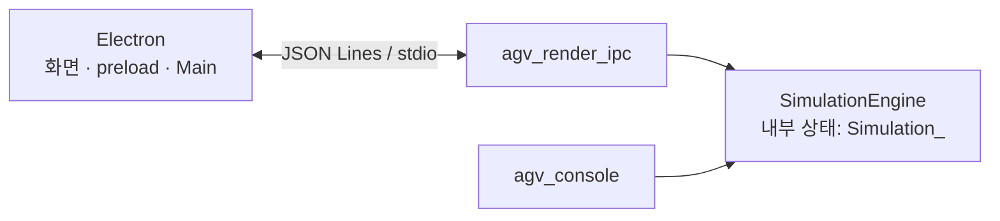
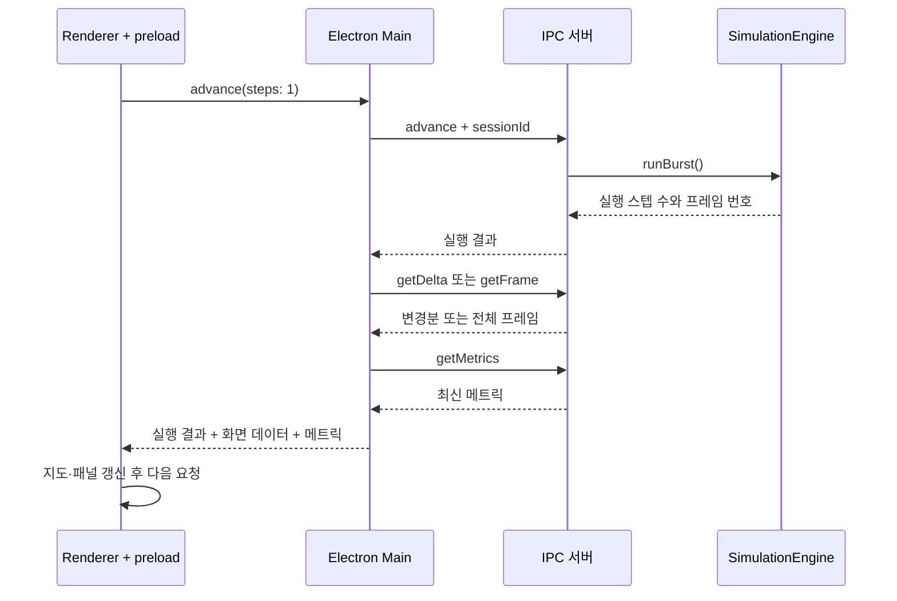

# 🧱 AGV 내부 구조 안내

[← 프로젝트 소개](../README.md) · [🎛️ UI 사용 가이드](../electron/README.md)

이 문서는 화면에서 누른 실행 버튼이 C++ 엔진에 전달되고, 계산 결과가 다시 지도와 지표로 표시되는 과정을 설명합니다. 코드에 등장하는 주요 이름과 수정할 파일을 함께 정리했습니다.

> **핵심 역할:** C++ 엔진이 AGV 상태와 이동을 계산하고, Electron이 실행을 제어하며 그 결과를 보여줍니다.

**바로 가기**

- [전체 구조와 폴더 역할](#architecture)
- [세션 생성과 실행 흐름](#execution)
- [엔진 내부와 AGV 상태](#engine)
- [경로 계획과 충돌 처리](#planning)
- [Electron 화면 구성](#electron)
- [IPC와 화면 동기화](#ipc)
- [테스트와 코드 수정 안내](#maintenance)

<a id="architecture"></a>

## 🗺️ 전체 구조와 폴더 역할

### 두 실행 방식이 하나의 엔진을 공유합니다



- **GUI 실행:** Electron이 `agv_render_ipc.exe`를 자식 프로세스로 실행하고 표준 입출력으로 메시지를 주고받습니다.
- **콘솔 실행:** `agv_console.exe`가 대화형 메뉴 또는 헤드리스 명령으로 같은 엔진을 사용합니다.
- **공개 API:** `SimulationEngine`이 설정·실행·조회 기능을 제공하고, 실제 상태는 내부 `Simulation_` 객체가 보유합니다.

[CMakeLists.txt](../CMakeLists.txt)는 공통 로직을 `agv_engine_core`, 콘솔 입출력을 `agv_console_shell`, JSON 입출력을 `agv_ipc_shell`로 나누어 빌드합니다.

### 폴더별로 무엇을 찾으면 되나요?

| 위치 | 담당하는 일 |
| --- | --- |
| [src/apps/](../src/apps/) | 콘솔·IPC 실행 파일의 `main()` 진입점 |
| [src/api/](../src/api/) | 공개 엔진 API 구현과 JSON 요청 처리 |
| [src/core/](../src/core/) | 시뮬레이션 생성·수명 관리, 공통 실행과 서비스 연결 |
| [src/runtime/](../src/runtime/) | 작업 배정, 한 스텝 실행, AGV 이동·상태 전이 |
| [src/planning/](../src/planning/) | 경로 탐색, 시간별 셀 예약, 충돌·교착 대응 |
| [src/maps/](../src/maps/) | 맵과 목표·홈·충전소 배치 |
| [src/ui/](../src/ui/) | 화면용 데이터 모델, 콘솔 표시와 설정 메뉴 |
| [src/reporting/](../src/reporting/) | 실행 요약, 성능 지표, 디버그 보고서 |
| [src/shell/](../src/shell/), [src/platform/](../src/platform/) | 콘솔 실행 제어와 터미널·운영체제 연결 |
| [include/agv/](../include/agv/) | 외부에서 사용하는 API와 스냅샷 자료형 |
| [include/agv/internal/](../include/agv/internal/) | 엔진 내부 객체, 상수, 서비스 인터페이스 |
| [electron/](../electron/) | 데스크톱 창, IPC 브리지, 화면과 입력 처리 |
| [tests/](../tests/), [scripts/](../scripts/) | 회귀 테스트와 빌드·테스트 자동화 |

`src/ui/render_model.cpp`는 C++ 상태를 화면용 데이터로 바꿉니다. 실제 Electron 지도는 `electron/renderer.js`의 Canvas 코드가 그립니다.

<a id="execution"></a>

## ▶️ 세션 생성과 실행 흐름

### 1. Setup에서 새 세션을 만듭니다

**세션**은 맵·알고리즘·시나리오 설정으로 시작한 한 번의 시뮬레이션입니다.

1. UI가 맵, 알고리즘, 시나리오, 시드를 `LaunchConfig`로 묶습니다.
2. `startSession` 요청을 받은 IPC 서버가 설정을 검증하고 정규화합니다.
3. 엔진이 새 `Simulation_`을 만들고 `sessionId`를 발급합니다.
4. Electron Main이 정적 지도, 첫 프레임, 메트릭을 받아 UI에 전달합니다.
5. UI가 세션을 일시정지 상태로 맞춥니다. 이후 **Run** 또는 **Single step**으로 진행합니다.

맵·알고리즘·시나리오 변경은 새 세션을 시작할 때 반영합니다. 프리셋은 UI에서 이 설정 묶음을 저장하고 다시 적용하는 기능입니다.

### 2. Run은 짧은 실행 요청을 반복합니다



현재 GUI는 한 번에 1스텝씩 요청합니다. **Run**은 이 과정을 반복하고, **Single step**은 한 번 진행한 뒤 다시 멈춥니다. 하단 **Speed**는 화면 재생 간격을 조절합니다.

관련 코드: [renderer.js](../electron/renderer.js), [main.js](../electron/main.js), [render_ipc_server.cpp](../src/api/render_ipc_server.cpp).

<a id="engine"></a>

## ⚙️ 엔진 내부와 AGV 상태

### 공개 API와 실제 상태를 구분합니다

| 구성 요소 | 역할 |
| --- | --- |
| `SimulationEngine` | 설정 검증, 세션 시작, `step()`·`runBurst()`, 스냅샷 조회 |
| `Simulation_` | 현재 맵·AGV·시나리오·플래너·통계를 소유하는 내부 객체 |
| `GridMap` | 격자 셀, 장애물, 목표 지점, 홈과 충전소 |
| `AgentManager` | AGV 위치·목표·작업 상태·대기 상태 |
| `ScenarioManager` | 사용자 정의 단계 또는 실시간 작업 대기열 |
| `Planner` | 선택된 `PlannerStrategy`에 다음 이동 계산을 위임 |
| `Logger` / `RenderModelCache` | 실행 로그와 화면 프레임·변경 이력 |

`SimulationEngine`은 구현을 `Impl`에 감추고 내부 시뮬레이션을 소유합니다. 맵이나 알고리즘 등 설정이 바뀌면 `dirty` 표시를 남기고, 다음 초기화가 필요한 접근에서 시뮬레이션을 다시 구성합니다. `startConfiguredSession()`은 새 세션을 명시적으로 시작하는 경로입니다.

자료형은 [simulation_engine.hpp](../include/agv/simulation_engine.hpp)와 [engine_model.hpp](../include/agv/internal/engine_model.hpp), 구현은 [simulation_engine.cpp](../src/api/simulation_engine.cpp)에 있습니다.

### 한 스텝에서 일어나는 일

[step_runtime.cpp](../src/runtime/step_runtime.cpp)의 `StepExecutorService`가 다음 순서로 실행을 묶습니다.

1. **충전·작업 준비** — 충전 상태를 갱신하고 시작 시점의 유휴 AGV를 기록합니다.
2. **작업 배정** — 시나리오에 따라 주차·출차 작업을 AGV에 배정합니다.
3. **이동 계산** — 플래너가 다음 위치를 계산하고, 알고리즘에 맞는 회전·충돌 처리를 수행합니다.
4. **이동·상태 반영** — 위치와 정체 상태를 갱신하고 목표 도착·작업 완료·복귀를 처리합니다.
5. **관측 데이터 갱신** — 실행 시간·작업량·교착 상태 등을 기록하고, 캡처 수준에 따라 프레임 변경분을 남깁니다.

**알고리즘별 차이:** `default`는 플래너가 반환한 다음 위치를 사용합니다. `astar`·`dstar`는 런타임에서 회전 대기, 정지 장애물, 우선순위 충돌 정리를 추가로 거칩니다. `plannedMoveCount`와 `finalMoveCount`는 이 과정에서 이동 후보가 실제 이동으로 얼마나 이어졌는지 보여줍니다.

### 시나리오와 작업 상태

| 시나리오 | 요청을 만드는 방식 |
| --- | --- |
| `custom` | `park:8 → exit:4`처럼 지정한 작업 단계를 순서대로 수행 |
| `realtime` | 주차·출차 확률로 요청을 만들고 대기열에 넣어 배정 |

AGV의 대표 상태 흐름은 다음과 같습니다.

- **주차:** `Idle → GoingToPark → ReturningHomeEmpty → Idle`
- **출차:** `Idle → GoingToCollect → ReturningWithCar → Idle`
- **충전:** `GoingToCharge → Charging → ReturningHomeMaintenance → Idle`

목표에 도착한 뒤에는 작업 타이머가 끝나야 다음 상태로 넘어갈 수 있습니다. 이동하지 않는 프레임을 해석할 때는 회전 대기·작업 수행·충전 상태도 함께 확인해야 합니다.

관련 코드: [scenario_runtime.cpp](../src/runtime/scenario_runtime.cpp), [agent_runtime.cpp](../src/runtime/agent_runtime.cpp), [agent_goal_support.cpp](../src/runtime/agent_goal_support.cpp).

<a id="planning"></a>

## 🧭 경로 계획과 충돌 처리

### 세 모드의 구현 관계

| UI 선택 | 구현 | 동작의 중심 |
| --- | --- | --- |
| `default` | `DefaultPlannerStrategy` | 시간별 경로 예약과 대기 관계를 살피고, 충돌 그룹 재계획·양보·우회 처리 |
| `astar` | `AStarOrderedPlanner` | 우선순위가 높은 AGV부터 다음 이동을 결정하는 순차 계획 |
| `dstar` | `DStarOrderedPlanner` | 같은 순차 계획 기반을 사용하며 알고리즘 표식·지표를 구분 |

현재 `astar`와 `dstar`는 `OrderedPlannerBase`와 `OrderedPlannerToolkit`, 공통 `Pathfinder`를 사용하며 알고리즘 표식과 지표 집계를 구분합니다. [전략 구현](../src/planning/collision_planner.cpp)에서 이 연결을 확인할 수 있습니다. 두 모드의 오버레이는 현재 위치와 다음 스텝을 중심으로 표시합니다.

### default 플래너를 이해하는 용어

| 개념 | 이 프로젝트에서 하는 일 |
| --- | --- |
| **WHCA / 예약 테이블** | 짧은 미래 구간에서 AGV가 사용할 셀과 시간을 예약 |
| **Wait-for graph / SCC** | 누가 누구를 기다리는지 연결하고 순환 대기 그룹을 파악 |
| **Partial CBS** | 충돌에 관련된 일부 AGV의 경로를 제약 조건과 함께 다시 탐색 |
| **양보·Pull-over** | 정체 상황에서 일부 AGV가 기다리거나 옆 공간으로 이동하도록 결정 |

기본 계획, 충돌 관계 분석, 필요 시 재계획·우회, 최종 충돌 정리 순으로 연결됩니다. 재계획은 설정된 시간 범위와 AGV 그룹 크기 안에서 수행합니다.

코드는 목적별로 나뉩니다.

- [collision_planner.cpp](../src/planning/collision_planner.cpp): 전략 선택과 순차 플래너
- [collision_planner_default_support.cpp](../src/planning/collision_planner_default_support.cpp): 기본 플래너 실행 흐름과 정체 대응
- [collision_planner_whca_support.cpp](../src/planning/collision_planner_whca_support.cpp): 시간축 경로 탐색·예약·CBS 지원
- [collision_planner_support.cpp](../src/planning/collision_planner_support.cpp), [pathfinder.cpp](../src/planning/pathfinder.cpp): 공통 경로 계산과 충돌 처리 지원

<a id="electron"></a>

## 🖥️ Electron 화면 구성

### 파일별 책임

| 파일 | 맡고 있는 일 |
| --- | --- |
| [main.js](../electron/main.js) | 창 생성, 백엔드 프로세스 실행·종료, 요청과 응답 연결, 세션 동기화 |
| [preload.js](../electron/preload.js) | `window.agvShell`에 화면에서 사용할 API만 노출 |
| [renderer.js](../electron/renderer.js) | 세션·화면 데이터 관리, 실행 제어, Canvas 지도, AGV 목록·지표·로그 렌더링 |
| [workspace-ui.js](../electron/workspace-ui.js) | 내비게이션, 패널 표시, 대화상자 포커스, 설정 피드백과 재생 속도 UI |
| [index.html](../electron/index.html), [styles.css](../electron/styles.css) | 화면 요소, 레이아웃, 글자·색·간격 |
| [motion-runtime.js](../electron/motion-runtime.js) | Motion 브라우저 번들을 화면 코드에서 사용할 수 있도록 연결 |

`contextIsolation: true`, `nodeIntegration: false`로 실행하며, 화면은 `preload.js`가 제공하는 API를 통해 Main에 요청합니다. Main의 `AgvBackendClient`가 백엔드에 JSON을 쓰고 `requestId`로 응답을 연결합니다.

### 사용자가 보는 화면과 데이터

- **Simulation:** AGV 목록 → 지도 → 선택 AGV 상세 정보. 하단에서 실행·일시정지·단계 진행을 제어합니다.
- **Setup:** 맵·알고리즘·시나리오·프리셋·캡처 수준을 설정하고 검증합니다.
- **Analysis:** 현재 메트릭과 프레임별로 쌓은 추세를 보여줍니다. 전체 지표는 **All metrics**에서 확인합니다.
- **Layers / Events:** 지도 오버레이와 엔진 로그를 필요에 따라 표시합니다.

`renderer.js`는 정적 지도인 `scene`, 현재 상태인 `frame`, 운영 지표인 `metrics`, 추세용 `metricHistory`를 나누어 관리합니다. `workspace-ui.js`는 같은 상태를 참조해 패널과 조작부를 맞추며, C++ 시뮬레이션 상태를 따로 계산하지 않습니다.

<a id="ipc"></a>

## 📨 IPC와 화면 동기화

### 메시지는 한 줄에 JSON 하나입니다

Electron Main과 C++ 프로세스는 stdin/stdout으로 **JSON Lines**를 주고받습니다. 프로토콜 버전은 `2`이며, 요청에는 `protocolVersion`, `requestId`, `command`가 들어갑니다.

아래는 프레임 조회 요청 예시입니다. `sessionId`에는 `startSession`으로 받은 실제 값을 넣습니다.

```json
{"protocolVersion":2,"requestId":"frame-1","command":"getFrame","sessionId":1}
```

응답은 요청의 `requestId`를 포함하고 `ok`로 성공 여부를 나타냅니다. 실패 응답에는 `errorCode`와 `message`가 추가됩니다.

| 요청 묶음 | 목적 |
| --- | --- |
| `getCapabilities`, `validateConfig` | 사용 가능한 맵·모드·설정 범위 조회와 입력 검증 |
| `startSession`, `advance`, `setPaused` | 세션 생성, 실행, 일시정지 제어 |
| `getStaticScene`, `getFrame`, `getDelta` | 정적 지도, 전체 상태, 특정 프레임 이후 변경분 조회 |
| `getMetrics`, `getLogs`, `getDebugSnapshot` | 지표·로그·진단 데이터 조회 |
| `subscribeFrameDelta`, `shutdown` | 프레임 변경 알림 구독과 백엔드 종료 |

현재 GUI의 화면 갱신은 `advance` 후 Main이 프레임과 지표를 조회하는 흐름을 사용합니다. 프로토콜의 구독 기능은 별도로 제공됩니다.

### 전체 프레임과 변경분을 섞지 않도록 식별합니다

| 값 | 의미 |
| --- | --- |
| `sessionId` | 어느 시뮬레이션 실행의 데이터인지 구분 |
| `sceneVersion` | 정적 지도 데이터의 버전 |
| `frameId` | 시뮬레이션 진행에 따른 프레임 번호 |
| `lastLogSeq` | 마지막으로 확인한 구조화 로그의 순번 |

초기 화면은 정적 지도와 전체 프레임으로 채웁니다. 이후 Main은 이전 `frameId`부터의 변경분을 요청합니다. 서버가 변경 이력을 제공할 수 없어 `requiresFullResync`를 반환하면 전체 프레임을 다시 받습니다. 이전 세션의 ID를 사용하면 `session_stale` 오류로 구분합니다.

### 캡처 수준에 따라 관측량이 달라집니다

| 수준 | 용도와 GUI 동작 |
| --- | --- |
| `none` | 프레임 변경 이력 캡처를 최소화. 현재 GUI는 실행 후 지도 동기화를 생략 |
| `metrics` | 지표 중심 관측. 현재 GUI는 실행 후 지도 동기화를 생략 |
| `frame` | 일반 GUI 실행용. 프레임과 변경분으로 지도·AGV 상태 갱신 |
| `debug` | `frame`에 플래너 경로·충돌 등 디버그 오버레이를 추가 |

플래너 레이어를 확인하려면 Setup의 캡처 수준을 **Debug**로 선택합니다. 데이터 생성은 [render_model.cpp](../src/ui/render_model.cpp), JSON 변환은 [render_ipc_server.cpp](../src/api/render_ipc_server.cpp), 화면 반영은 `renderer.js`의 `applyFrame()`·`applyDelta()`가 담당합니다.

<a id="maintenance"></a>

## 🧪 테스트와 코드 수정 안내

### 테스트가 확인하는 경계

| 테스트 | 주요 확인 대상 |
| --- | --- |
| [launch_workflow_test.cpp](../tests/launch_workflow_test.cpp) | 설정 검증·정규화, 세션 생성, 잘못된 요청 처리 |
| [simulation_engine_test.cpp](../tests/simulation_engine_test.cpp) | 시나리오, 경로 계획, 충돌·정체, 작업·충전 상태 |
| [render_model_test.cpp](../tests/render_model_test.cpp) | 정적 지도, 프레임·변경분 재생, 오버레이, IPC 세션 흐름 |
| [debug_support_test.cpp](../tests/debug_support_test.cpp) | 로그, 디버그 스냅샷, 보고서 파일 |
| [core_boundary.cmake](../tests/core_boundary.cmake) | 엔진 핵심 파일에서 셸 전용 헤더를 참조하지 않는지 검사 |
| [no_c_smells.cmake](../tests/no_c_smells.cmake) | 저장소에서 제한한 C 스타일 패턴 검사 |

루트의 `build_one_click.bat -Task test -BuildType Debug`는 테스트용 빌드 후 GoogleTest와 `no_c_smells` 검사를 실행합니다. CMake에 등록된 테스트 전체는 테스트용 빌드 후 `ctest --test-dir build-codex --output-on-failure`로 실행할 수 있으며, 여기에는 `core_boundary`도 포함됩니다.

### 바꾸려는 기능에서 시작할 파일 찾기

| 변경하려는 내용 | 먼저 확인할 파일 |
| --- | --- |
| 화면 배치·색·간격 | `electron/index.html`, `electron/styles.css` |
| 패널·대화상자·내비게이션 | `electron/workspace-ui.js` |
| 지도·AGV·분석 표시 | `electron/renderer.js` |
| 새 맵과 선택 항목 | `src/maps/map_catalog.cpp`, `src/ui/launch_ui_metadata.cpp`, IPC capability의 맵 범위 |
| 작업 배정·주차·출차·충전 | `src/runtime/scenario_runtime.cpp`, `agent_runtime.cpp`, `agent_goal_support.cpp` |
| 경로 계획 전략 | `src/planning/collision_planner.cpp`와 관련 지원 파일, `planner_from_pathalgo()` |
| 새 메트릭·프레임 필드 | 공개 스냅샷 자료형 → C++ 수집·렌더 모델 → IPC 직렬화 → Electron 표시 |

공개 데이터 필드를 추가할 때는 C++에서 값을 만드는 부분과 JSON으로 전달하는 부분, UI에서 읽는 부분을 함께 확인합니다. 동작이나 계약이 바뀌면 해당 테스트도 함께 갱신합니다.

처음 코드를 읽는다면 **[공개 API](../include/agv/simulation_engine.hpp) → [엔진 구현](../src/api/simulation_engine.cpp) → [한 스텝 실행](../src/runtime/step_runtime.cpp) → 관심 있는 기능의 파일** 순서가 좋습니다.
